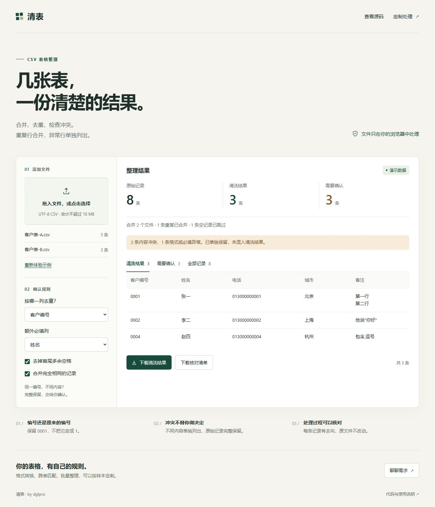

# 清表

把几份 CSV 合成一份可用的表。重复行合并，内容冲突和缺失项单独列出。

[在线试用](https://dglpro.github.io/csv-cleaning-demo/) · [定制处理](https://github.com/dglpro/csv-cleaning-demo/issues/new?template=service-request.yml)



- 文件在浏览器内处理，无需安装或上传服务器。
- 编号和电话保持文本，保留前导零。
- 冲突不自动覆盖，核对清单标明来源文件和记录编号。
- 可下载清洗结果，也可下载完整源码离线使用。

网页支持表头一致的 UTF-8 CSV，合计不超过 10 MB。打开即有演示数据，也可以选择自己的文件。

## 本地使用

直接打开 `index.html` 即可使用网页。批量处理可运行命令行版，需要 Node.js 20 或以上版本，无第三方依赖：

```sh
node clean-csv.mjs --config rules.json --out my-result samples/customers-a.csv samples/customers-b.csv
```

输出 `cleaned.csv` 和 `report.json`，原文件不改动，已有输出目录不会覆盖。用 Excel 查看时按文本导入，保留编号格式。

`rules.json` 中，`keys` 指定去重列，`trim` 指定去除两端空格的列，`required` 指定必填列；`deduplicate: false` 可保留完全相同的记录。命令行支持多列组合键。

## 修改与验证

网页与命令行共用 `csv-core.mjs`。修改网页源码后重新构建：

```sh
node build.mjs
node verify.mjs
```

演示的 8 条记录得到 3 条结果、1 条重复、2 条冲突、1 条必填缺失和 1 条空记录，见 `sample-result/`。

实现与验证使用 Codex 辅助。示例数据均为虚构。
